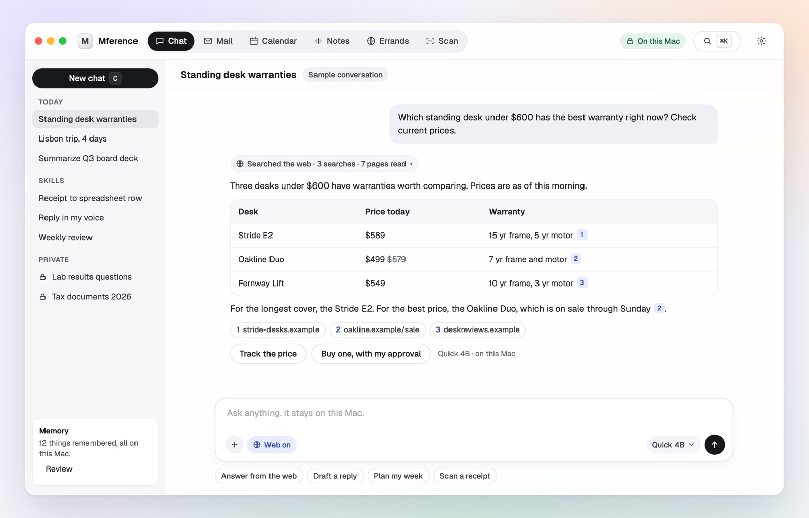
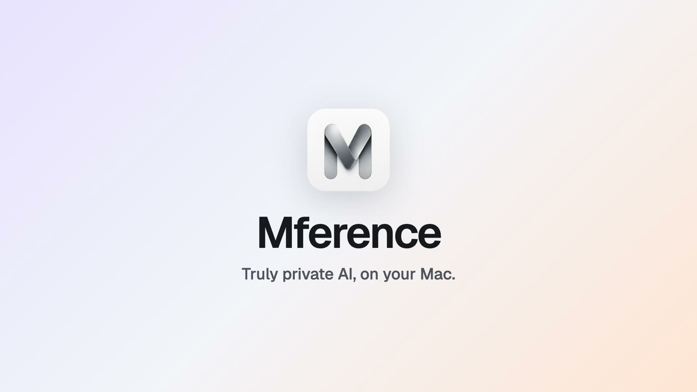
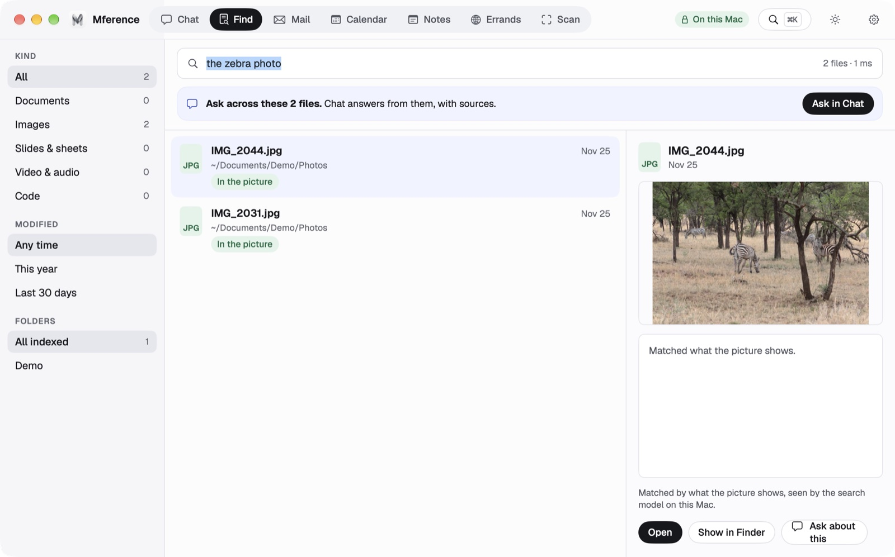
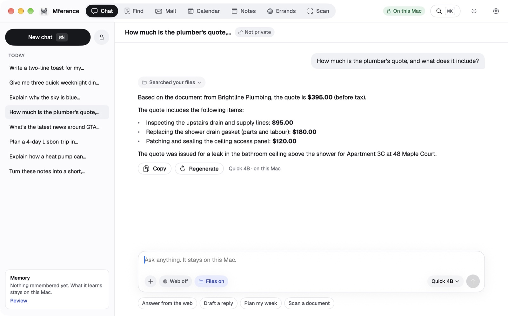
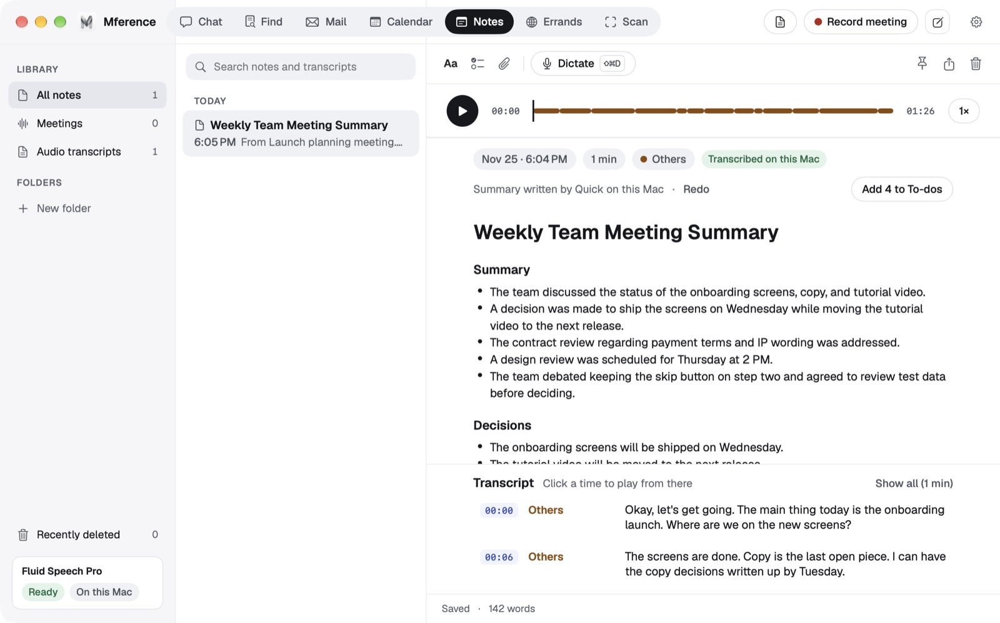
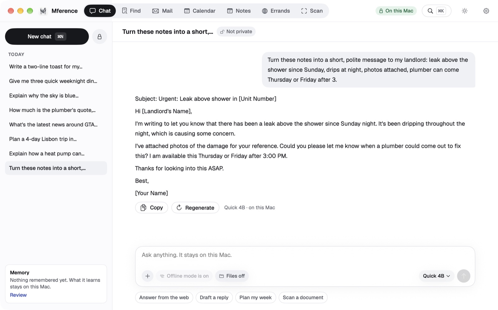
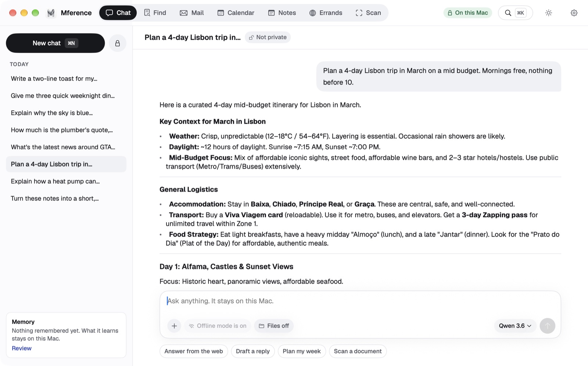
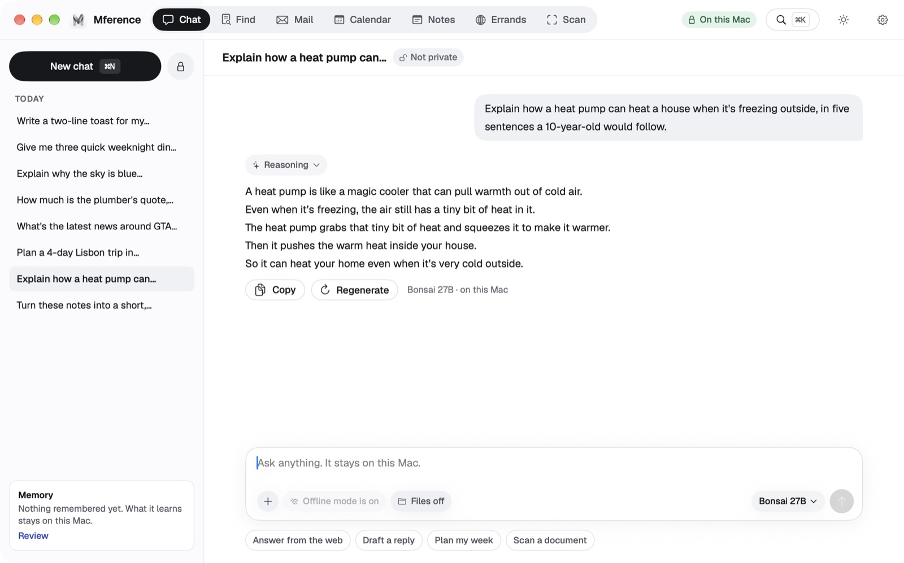

<p align="center">
  <a href="https://neelm0906.github.io/Mference/"></a>
</p>

<h1 align="center">Mference</h1>

<p align="center">
  <b>Truly private AI, on your Mac.</b><br>
  Run several models and pick the right one for the job. Chat with your files,
  find files by what is in them, scan images, search the web when you want to,
  and keep your calendar and to-dos in step with your Mac. Nothing leaves it
  unless you ask.
</p>

<p align="center">
  
</p>

<p align="center">
  <a href="https://neelm0906.github.io/Mference/assets/film/mference-launch.mp4"></a><br>
  <a href="https://neelm0906.github.io/Mference/assets/film/mference-launch.mp4"><b>▶ Watch the 52-second film</b></a>
</p>

## What it does

- **Runs several models, all on your Mac.** Quick ones for everyday replies,
  Deep ones for harder work, and large mixture-of-experts models that stream
  from the SSD. Pick one per chat; the app shows how much memory each needs
  before you load it. [The models](#models).
- **Chat with your files.** Ask about a lease, a quote or your notes, and the
  answer comes back with the files it used.
- **Find files by what is in them**: "the lease clause about pets", "that
  screenshot with the wifi password", "the zebra photo". Word matches show as
  you type and meaning matches follow, from any app with ⌥Space. The index and
  its small search model stay on your Mac.
- **Scan images.** Receipts, documents and screenshots are read on the Mac,
  and the model fills in merchant, date, total and tax for you to check.
- **Search the web when you need it.** Turn it on for a chat and answers come
  back with numbered sources, through a search engine bundled inside the app.
  Offline mode turns it off, along with chat and speech model downloads.
- **Calendar and to-dos, in step with your Mac.** Your Mac's calendars in day,
  week, month and year views, to-dos synced with Reminders, and questions about
  your week answered from your own calendar.
- **Notes** with checklists, headings and attachments, kept on your Mac.
  Dictate into any note, record a meeting with speaker labels and get its
  decisions and action items, or transcribe an audio file.
- **Mail** reads your Apple Mail mailboxes and drafts replies in your voice.
  Nothing is sent until you press Send.

<table>
  <tr>
    <td width="50%"><br><sub><b>Find</b> matches what is in a picture, not just its name.</sub></td>
    <td width="50%"><br><sub><b>Chat from your files</b>: the plumber's quote, itemised.</sub></td>
  </tr>
  <tr>
    <td><br><sub><b>Mail</b> drafts a reply in your voice. You press Send.</sub></td>
    <td><br><sub><b>Calendar</b> answers questions about your week.</sub></td>
  </tr>
  <tr>
    <td><br><sub><b>Notes</b> turns a meeting into decisions and action items.</sub></td>
    <td><br><sub><b>Scan</b> reads a receipt into fields you check.</sub></td>
  </tr>
</table>

### No internet, same assistant

Every answer below was written with Offline mode on, by a different model.

<table>
  <tr>
    <td width="33%"><br><sub><b>Quick 4B</b>: notes into a message.</sub></td>
    <td width="33%"><br><sub><b>Qwen 3.6</b>: a four-day trip plan.</sub></td>
    <td width="33%"><br><sub><b>Bonsai 27B</b>: a heat pump for a 10-year-old.</sub></td>
  </tr>
</table>

Your chats, notes, files, mail and calendar stay on the Mac. The app asks for
Calendar, Reminders, Mail, Full Disk Access, the microphone, call audio, the
camera or Photos only when you first use the feature that needs it.

<sub>Screenshots are from the app itself, running with demo data: the mail,
calendar and files, and the people in them, are invented. Web answers are live
model output, shown as generated.</sub>

## Models

Three kinds, all running on your Mac. Every figure below is from one 32 GB
M1 Max at a 512-token prompt: indicative, not a protocol benchmark, and your
Mac will differ.

**Quick: 5B and under.** Fast, small, and fine on any Apple Silicon Mac.

| Model | On disk | Prefill / decode (tok/s) | Peak memory |
| --- | ---: | --- | ---: |
| [Qwen3.5-4B](https://huggingface.co/unsloth/Qwen3.5-4B-GGUF) UD-Q4_K_XL (the default) | 2.9 GB | 599 / 50 | 1.3 GB |
| [MiniCPM5-2B](https://huggingface.co/openbmb/MiniCPM5-2B) | 1.4 GB | 422 / 72 | 0.8 GB |
| [MiniCPM5-1B](https://huggingface.co/openbmb/MiniCPM5-1B-MLX) MLX 4-bit | 0.6 GB | 990 / 154 | 0.2 GB + 0.6 GB mapped |

**Deep: 27B dense.** Harder reasoning and longer documents. Both draft several
tokens per step (MTP) and check them, so they answer faster.

| Model | On disk | Prefill / decode (tok/s) | Peak memory |
| --- | ---: | --- | ---: |
| [Qwen3.8-27B GSQ-RCO](https://huggingface.co/ISTA-DASLab/Qwen3.8-27B-GSQ-RCO-GGUF) IQ3_S | 12.1 GB | 85 / 17 | 3.1 GB + 12.1 GB mapped |
| [Ternary Bonsai 2.5 27B](https://huggingface.co/prism-ml/Ternary-Bonsai-2.5-27B-GGUF) Q2_0 | 7.9 GB | 95 / 22 | 3.2 GB + 7.9 GB mapped |

**Streamed mixture-of-experts.** Large models that keep only their shared
weights in memory and read the experts each token needs from the SSD.

| Model | On disk | Prefill / decode (tok/s) | Peak memory |
| --- | ---: | --- | ---: |
| [Qwen 3.6 35B-A3B](https://huggingface.co/Qwen/Qwen3.6-35B-A3B) | 19.6 GB | 258 / 29 | 8.3 GB |
| [Maple Preview](https://huggingface.co/deepgrove/maple-preview-2bit-mlx) 20B-A1B | 6.6 GB | 44 / 33 | 0.7 GB |
| [Inkling 2 Mini](https://huggingface.co/unsloth/Inkling-2-Mini-GGUF) UD-Q4_K_XL (looped), 32 GB Macs and up | 17.7 GB | 229 / 26 | 14.4 GB |

Qwen 3.6 also runs in about 1.5 GB with a smaller expert cache. Inkling 2 Mini
is the exception to streaming: on 32 to 47 GB Macs it keeps the experts of its
looped core in memory and reads the rest ahead of use, and from 48 GB it keeps
every layer.

## Get started

Mference is pre-release: there is no signed download yet, so you build it from
source. You need an Apple Silicon Mac with macOS 26 or later and Xcode 26 (or
its Command Line Tools).

```sh
git clone https://github.com/NeelM0906/Mference.git
cd Mference
App/Scripts/searxng/prepare.sh --fetch   # once: fetches and verifies the bundled search engine
App/Scripts/run.sh                       # builds, bundles and opens the app
```

On first run the app helps you pick a model. Qwen3.5-4B, Qwen3.8-27B and Bonsai
download from inside the app into `~/llm-models/gguf/`. The other five are
installed from the terminal, and the app finds them in `~/llm-models` on its own:

```sh
swift run -c release MferenceRepack --model qwen36 --output ~/llm-models/qwen36.gturbo
# or --model minicpm5 / minicpm5-1b / maple / inkling2mini; resume an interrupted install with --resume
```

## For developers

The app runs on `MferenceEngine`, which serves every model through one API
with two backends: Mference's own Swift and Metal runtime for `.gturbo`
installs, and llama.cpp, linked in-process, for GGUF files. The same engine
powers an OpenAI-compatible local server and a command-line tool.

- [Engine API](docs/ENGINE.md)
- [Local OpenAI-compatible server](docs/OPENAI_SERVER.md) and
  [runtime controls](docs/RUNTIME_CONTROLS.md)
- [Benchmarking your Mac](docs/COMMUNITY_BENCHMARKS.md)
- [CLAUDE.md](CLAUDE.md) for architecture, commands and invariants,
  [CONTRIBUTING.md](CONTRIBUTING.md) before a pull request, and
  [SECURITY.md](SECURITY.md) to report a security issue

## License

New Mference code is [MIT](LICENSE). Its foundation comes from
[TurboFieldfare](https://github.com/drumih/turbo-fieldfare) by Andrey
Mikhaylov ([Apache 2.0](LICENSE-APACHE)). Vendored llama.cpp and ggml are
under [LICENSE-GGML](LICENSE-GGML) and Maple's MLX-derived kernels under
[LICENSE-MLX](LICENSE-MLX). The app bundles SearXNG (AGPL-3.0, shipped with
its source) and the Geist font (OFL). See
[THIRD_PARTY_NOTICES.md](THIRD_PARTY_NOTICES.md).

Model weights are not part of this repository and keep their own licenses.
[Maple Preview](https://huggingface.co/deepgrove/maple-preview) is MIT; its
2-bit MLX repository added the same MIT card after the revision Mference pins.
