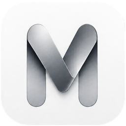
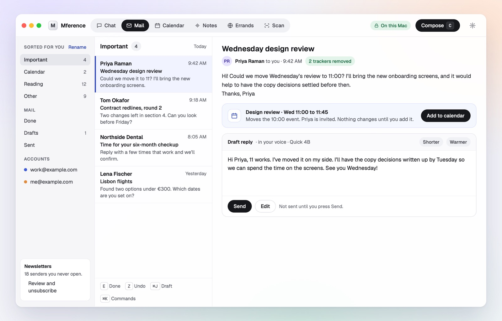
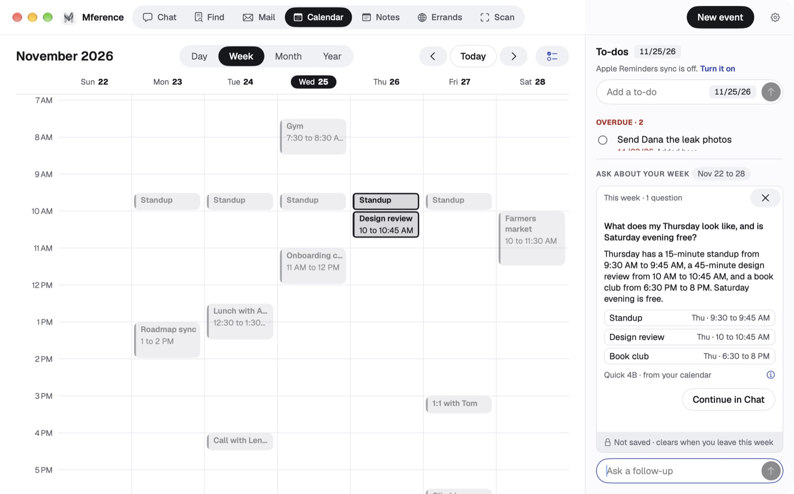
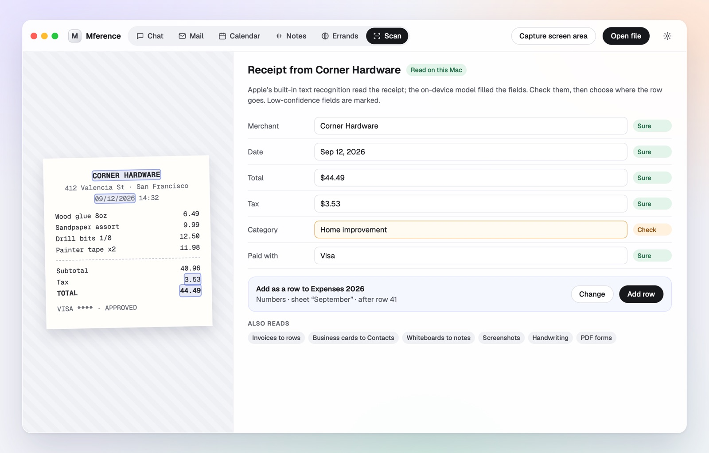

<p align="center">
  <a href="https://neelm0906.github.io/Mference/"></a>
</p>

<h1 align="center">Mference</h1>

<p align="center">
  A private AI assistant that runs entirely on your Mac.<br>
  Chat, search the web, sort your mail, plan your week and read receipts,
  with nothing leaving the machine.
</p>

<p align="center">
  
</p>

## What it does

- **Chat** with a local model. Turn on web search and answers come back with
  numbered citations, through a search engine bundled inside the app. Offline
  mode turns off all network use.
- **Find** files by what is in them: "the lease clause about pets", "that
  screenshot with the wifi password". Word matches show as you type and
  meaning matches follow, from any app with ⌥Space. Turn on photos, video and
  audio to find "the zebra photo", the moment in a video, or the voice memo
  about the plumber, in your folders and, if you allow it, your Photos
  library. Chat can answer from your files with sources. The index
  and its small search model stay on your Mac.
- **Mail** reads your Apple Mail mailboxes and drafts replies in your voice.
  Nothing is sent until you press Send.
- **Calendar and to-dos.** Day, week, month and year views of your calendars,
  events proposed from your mail, and to-dos kept in sync with Reminders.
- **Scan** a receipt or document. On-device text recognition reads it, and
  the model fills in merchant, date, total and tax for you to check.
- **Models** download from inside the app, and the app shows how much memory
  each one needs on your Mac before you load it.

Your chats, files, mail and calendar stay on the Mac. The app asks for
Calendar, Reminders, Mail or Full Disk Access only when you first use the
feature that needs it.

<table>
  <tr>
    <td></td>
    <td></td>
    <td></td>
  </tr>
</table>

<sub>Images are design renders. The shipped app may differ in detail, and the
Notes and Errands tabs they show are not built yet.</sub>

## Models

| Slot | Model | On disk | Prefill / decode (tok/s) | Peak memory |
| --- | --- | ---: | --- | ---: |
| Quick | [Qwen3.5-4B](https://huggingface.co/unsloth/Qwen3.5-4B-GGUF) UD-Q4_K_XL | 2.9 GB | 599 / 50 | 1.3 GB |
| Deep | [Qwen3.8-27B GSQ-RCO](https://huggingface.co/ISTA-DASLab/Qwen3.8-27B-GSQ-RCO-GGUF) IQ3_S, MTP | 12.1 GB | 85 / 17 | 3.1 GB + 12.1 GB mapped |
| Bonsai | [Ternary Bonsai 2.5 27B](https://huggingface.co/prism-ml/Ternary-Bonsai-2.5-27B-GGUF) Q2_0, MTP | 7.9 GB | 95 / 22 | 3.2 GB + 7.9 GB mapped |
| | [Qwen 3.6 35B-A3B](https://huggingface.co/Qwen/Qwen3.6-35B-A3B) (MoE) | 19.6 GB | 258 / 29 | 8.3 GB |
| | [MiniCPM5-2B](https://huggingface.co/openbmb/MiniCPM5-2B) | 1.4 GB | 422 / 72 | 0.8 GB |
| | [MiniCPM5-1B](https://huggingface.co/openbmb/MiniCPM5-1B-MLX) MLX 4-bit | 0.6 GB | not yet measured | not yet measured |
| | [Maple Preview](https://huggingface.co/deepgrove/maple-preview-2bit-mlx) 20B-A1B (MoE) | 6.6 GB | 44 / 33 | 0.7 GB |
| | [Inkling 2 Mini](https://huggingface.co/unsloth/Inkling-2-Mini-GGUF) UD-Q4_K_XL (looped MoE), 32 GB Macs and up | 17.7 GB | 229 / 26 | 14.4 GB |

Indicative readings from one 32 GB M1 Max with a 512-token prompt, not
protocol benchmarks; your Mac will differ. The mixture-of-experts models keep
only their shared weights in memory and read the experts each token needs
from the SSD, so Qwen 3.6 also runs in about 1.5 GB with a smaller expert
cache. Inkling 2 Mini is the exception: on 32 to 47 GB Macs it keeps the
experts of its looped core in memory and reads the rest ahead of use, and from
48 GB it keeps every layer. It is offered on Macs with 32 GB or more.

## Get started

Mference is pre-release: there is no signed download yet, so you build it from
source. You need an Apple Silicon Mac with macOS 26 or later and Xcode 26 (or
its Command Line Tools).

```sh
git clone https://github.com/NeelM0906/Mference.git
cd Mference
App/Scripts/searxng/prepare.sh --fetch   # once: fetches and verifies the bundled search engine
App/Scripts/run.sh                       # builds, bundles and opens the app
```

On first run the app helps you pick a model. Quick, Deep and Bonsai download
from inside the app into `~/llm-models/gguf/`. The other five are installed from
the terminal, and the app finds them in `~/llm-models` on its own:

```sh
swift run -c release MferenceRepack --model qwen36 --output ~/llm-models/qwen36.gturbo
# or --model minicpm5 / minicpm5-1b / maple / inkling2mini; resume an interrupted install with --resume
```

## For developers

The app runs on `MferenceEngine`, which serves every model through one API
with two backends: Mference's own Swift and Metal runtime for `.gturbo`
installs, and llama.cpp, linked in-process, for GGUF files. The same engine
powers an OpenAI-compatible local server and a command-line tool.

- [Engine API](docs/ENGINE.md)
- [Local OpenAI-compatible server](docs/OPENAI_SERVER.md) and
  [runtime controls](docs/RUNTIME_CONTROLS.md)
- [Benchmarking your Mac](docs/COMMUNITY_BENCHMARKS.md)
- [CLAUDE.md](CLAUDE.md) for architecture, commands and invariants,
  [CONTRIBUTING.md](CONTRIBUTING.md) before a pull request, and
  [SECURITY.md](SECURITY.md) to report a security issue

## License

New Mference code is [MIT](LICENSE). Its foundation comes from
[TurboFieldfare](https://github.com/drumih/turbo-fieldfare) by Andrey
Mikhaylov ([Apache 2.0](LICENSE-APACHE)). Vendored llama.cpp and ggml are
under [LICENSE-GGML](LICENSE-GGML) and Maple's MLX-derived kernels under
[LICENSE-MLX](LICENSE-MLX). The app bundles SearXNG (AGPL-3.0, shipped with
its source) and the Geist font (OFL). See
[THIRD_PARTY_NOTICES.md](THIRD_PARTY_NOTICES.md).

Model weights are not part of this repository and keep their own licenses.
Maple's checkpoint declares none, so establish your rights before you
download, use or redistribute it.
