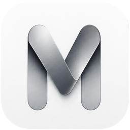

<p align="center">
  <a href="https://neelm0906.github.io/Mference/"></a>
</p>

**Mference** lets you run mixture-of-experts models that are much bigger than
your Mac's memory, on Apple Silicon, at usable speeds. A MoE model only uses a
few of its experts for each token, so Mference keeps the shared weights and the
KV cache in RAM and reads just the experts the current token needs from SSD.
The whole model never has to fit in memory: Qwen3.8-Flash-Next, a ~175 GB
install, decodes in about 2.36 GB. It is a native Swift and Metal engine that
you use from the command line, through a local OpenAI-compatible server, or
from the browser with Open WebUI.

The engine is deliberately narrow. It is not a general model loader and not a
wrapper around MLX or llama.cpp: every supported model is a pinned checkpoint
with its own installer path, kernels and tests, and you use the installs that
Mference itself produces. Installer, runtime, server and UI are built and
tested together.

Website: **https://neelm0906.github.io/Mference/**

## Models

These are the models you can install today, with the memory they use while
running and the decode speeds reported in this repository.

| Model | Total / active params | Installed | Memory while running | Reported decode |
| --- | --- | ---: | --- | --- |
| [Qwen3.8-Flash-Next](docs/families/QWEN38_FLASH_NEXT.md) | 180B / 3.5B | 175 GB | 2.36 GB (16 slots) | 11.1–11.8 tok/s at 2.36 GB · 18.2–21.0 tok/s with the ~68 GiB routed pool mapped (M3 Ultra 256 GB)¹ |
| [GLM-5.3-Flash](docs/families/GLM53_FLASH.md) | 320B / 18B | 181 GB | 160 GiB (all experts resident) | 19.2–25.8 tok/s (M3 Ultra 256 GB)² |
| [DeepSeek-V4-Flash](docs/DEEPSEEK_V4_FLASH.md) *(experimental)* | 284B / 13B | 91 GB | 5.7 GB | 5.6–6.7 tok/s (M3 Ultra 256 GB) |
| [Inkling-Small](docs/INKLING_SMALL.md) | 276B / 12B | 148 GB | 9 GB | 3.0–3.7 tok/s (M5 24 GB) · 5.3–7.1 (M3 Ultra) |
| [Qwen 3.6](https://huggingface.co/Qwen/Qwen3.6-35B-A3B) | 35B / 3B | 19.6 GB | 1.45 GB (16 slots) | 23.5–29.3 tok/s (M5 24 GB) · 36.1–42.2 (M3 Ultra)³ |
| [Gemma 4](https://ai.google.dev/gemma/docs/core/model_card_4) | 26B / 3.88B | 14.3 GB | 2 GB | 5.1–6.3 tok/s (M2 Air 8 GB) · 31–35 (M5 Pro 24 GB) · 17.1–18.7 (M3 Ultra) |
| [Gemma 4 QAT](docs/families/GEMMA4_QAT.md) | 26B / 3.88B | 14.45 GB | 2.16 GiB | 7.11 tok/s (M2 Air 16 GB)⁴ |
| [Flint](docs/families/FLINT.md) *(in port)* | 40B / 2.5B | 23.4 GB | ~1.3 GB expert cache (16 slots) | 9.59–12.88 tok/s (M5 24 GB)⁵ |
| [Maple Preview](https://huggingface.co/deepgrove/maple-preview-2bit-mlx) | 20B / 1B | 6.6 GB | 491–1,211 MiB | 18.9–24.6 tok/s (M4 16 GB) · 38.5 (M3 Ultra) |
| [Qwen 3.8 27B](https://huggingface.co/mlx-community/Qwen3.8-27B-4bit) (dense) | 27B / 27B | 15 GB | 15 GB (fully resident) | 15.0 tok/s with MTP, 7.9 plain (M5 24 GB) · 38.4–39.4 (M3 Ultra) |
| [MiniCPM5-2B](docs/families/MINICPM5.md) (dense) | 2B / 2B | 1.43 GB | 123 MiB | 65.56 tok/s (M5 24 GB) |

Sizes and memory are approximate, as reported in the docs. Speeds follow the
[community benchmark protocol](docs/COMMUNITY_BENCHMARKS.md) unless a note
says otherwise. They are measurements on specific Macs, not promises for yours.

1. The fast numbers need the whole ~68 GiB routed-expert pool mapped, which the
   automatic setting only does on hosts with at least 192 GiB. The 2.36 GB,
   16-slot path is the one smaller Macs get; it has been measured on the
   M3 Ultra, not yet on a small Mac.
2. Protocol run with one stated deviation: reasoning effort set to `low`. At the
   template's default effort the model does not finish thinking inside the
   protocol's 1,024-token cap.
3. A later change (PR #47) measured 29.6–32.5 tok/s on a 24 GB M4 Pro with a
   506-token prompt and greedy decoding. That was not a protocol run.
4. Diagnostic run with cool-downs on a fanless MacBook Air, not the community
   protocol.
5. First-light run at 16 / 32 / auto expert slots with a 5-token prompt. Flint is
   still being ported and has not passed the family gate.

Two dense models (Qwen 3.8 27B and MiniCPM5-2B) are in the list too. They do not
stream, but they share the same runtime, installer and server.

**Model support is intentionally selective.** A family is added when it
exercises an important new architecture, strengthens the "bigger than memory"
idea, or is a useful calibration point for the porting process. The goal is not
a long model list.

## Supported hardware

* **Apple Silicon Macs only** (arm64), macOS 15 or later, Metal 3.
* How much RAM you need depends on the model. The low-memory streamed families
  run on an 8 GB Mac; the dense Qwen 3.8 27B needs a 24 GB-class Mac; GLM-5.3-Flash
  is targeted at a 256 GiB host, where all of its experts stay resident.
* A fast local SSD matters, because that is where the experts come from.
* On macOS 26 the shaders compile at MSL 4.0 and use the Metal 4 tensor-ops
  prefill kernels where their pipelines build (some need an Apple10 GPU). On
  macOS 15 they compile at MSL 3.2 with the non-tensor kernels. Both paths run
  everything and agree within kernel tolerance, not bit for bit, so expect the
  same quality but not identical sampled tokens.

# So, what can I do with this software?

* Run a 180B-parameter MoE (Qwen3.8-Flash-Next) on a Mac with a ~2.36 GB
  working set, or at 18–21 tok/s on a 256 GB Mac Studio where its expert pool
  fits in memory.
* Run a capable everyday model on the Mac you already have: Qwen 3.6 decodes at
  23.5–29.3 tok/s on a 24 GB M5 while using ~1.45 GB in its memory-first mode,
  and Gemma 4 runs on an 8 GB MacBook Air.
* Point any OpenAI-compatible client at a local Chat Completions server, or
  reach it from your own devices over Tailscale.
* Use a normal chat UI in the browser (Open WebUI) with a model picker that
  swaps models in place, one resident at a time.
* Go past RAM on context too: Qwen 3.8 27B pages its KV cache to SSD for long
  contexts, up to the model's 262k tokens.

## Motivations

* Mixture-of-experts models touch only a small part of their weights per token,
  so the full model does not need to sit in RAM.
* Apple Silicon Macs have fast SSDs and unified memory, which makes reading
  experts on demand practical.
* An engine specialized for a few pinned checkpoints can fuse, schedule and
  size everything for exactly those models, instead of carrying generic
  dispatch for every model.
* Running where another engine cannot is not enough. Each port should also
  reach the best throughput we can measure on its target Mac.

## Status

This is a **source release for Apple Silicon Macs**, not a signed Mac app and
not a bundle of model weights. The code changes quickly. Tagged source bundles
with provenance and checksums are on
[GitHub Releases](https://github.com/NeelM0906/Mference/releases); the
[0.1.0 release gate](docs/RELEASE_GATE_0.1.0.md) records exactly what was
checked. Cloning `main` gets you the latest development source, which may be
less stable than a tag. Models marked *experimental* or *in port* are
exactly that.

# How to use this project

## Start here

You need macOS 15+, Swift 6.1+ (Xcode 16.3+ or the matching Command Line
Tools), and [`uv`](https://github.com/astral-sh/uv) if you want the browser UI
(`brew install uv`). The CLI and the server do not need Python.

```sh
git clone https://github.com/NeelM0906/Mference.git
cd Mference
./mference-ui.sh doctor          # checks prerequisites; downloads nothing
swift build -c release
./mference-ui.sh install gemma4  # streams and repacks the pinned checkpoint (~14 GB)
./mference-ui.sh                 # starts the server and the UI at http://127.0.0.1:3000
```

Gemma 4 is the recommended first install. On a 24 GB-class Mac, Qwen 3.6 is
the established general-purpose choice. The first run is slow: the build, the
pinned Open WebUI install, the model download and its integrity checks all take
time. Later launches reuse everything. If a download is interrupted, run the
same command with `--resume` instead of starting over.

Install more models the same way and they show up in the UI's model picker:

```sh
./mference-ui.sh install qwen36   # also: gemma4qat, maple, qwen38, minicpm5, inklingsmall,
                                  #       deepseekv4flash, qwen38flashnext, glm53flash, flint
./mference-ui.sh models           # what the server would expose, without loading anything
```

Pick the way you want to use it:

| You want | Guide | Entry point |
| --- | --- | --- |
| A chat UI in the browser | [The Mference UI (Open WebUI)](docs/OPEN_WEBUI.md) | `./mference-ui.sh` |
| An API for your own clients | [OpenAI-compatible server](docs/OPENAI_SERVER.md) | `MferenceServer` |
| A terminal, scripts, or diagnostics | [Runtime controls](docs/RUNTIME_CONTROLS.md) | `MferenceCLI` |

Installed sizes, release roles and known limits for every checkpoint are in
[checkpoint choices and limits](docs/RELEASE_SUPPORT.md).

## Everyday use

### Browser UI

`./mference-ui.sh` starts `MferenceServer` in library mode and opens Open WebUI.
The server lists every install it finds (in the checkout's `scratch/`,
`~/llm-models`, or `~/Library/Application Support/Mference`) and swaps the
loaded model in place when you pick another one. Only one model is ever
resident. The launcher turns off Open WebUI's builtin tool schemas for Mference
models, because otherwise a one-line question costs thousands of prompt
tokens. Chats and settings stay in Open WebUI's local data directory.

### Command line

```sh
# Install a model without the UI (streams and repacks; never holds the full checkpoint)
swift run -c release MferenceRepack --model qwen36 --output scratch/qwen36.gturbo

# Chat, using the checkpoint's own template
swift run -c release MferenceCLI --model scratch/qwen36.gturbo --chat

# Raw completion
swift run -c release MferenceCLI --model scratch/qwen36.gturbo \
  --prompt "The capital of France is" --max-new 64
```

`--prompt` is raw completion input, not a chat message. For instruction models
use `--chat`, or `--messages-file` with a JSON message history. Every flag is
in [runtime controls](docs/RUNTIME_CONTROLS.md).

### Server

```sh
swift build -c release --product MferenceServer
.build/release/MferenceServer --model scratch/gemma4.gturbo --port 8080 --max-context 16384
```

Wait for `MferenceServer ready`, then use any OpenAI-compatible client.
`--library` serves every installed model from one process, and
`--bind tailnet` binds only your Tailscale IPv4 address. The server picks each
model's native chat and tool-call format automatically. See the
[server guide](docs/OPENAI_SERVER.md).

> The server and Open WebUI bind to loopback, the server has no authentication
> or TLS, and Open WebUI runs with authentication off. Do not expose either port.

Run one model-owning process at a time.

### Model extras

* **Qwen 3.8 27B** ships MTP speculative decoding with byte-identical greedy
  output (2.35× mlx-vlm on the same checkpoint), an opt-in
  [DFlash2 drafter](docs/QWEN38_DFLASH2.md), and
  [long context past RAM](docs/QWEN38_LONG_CONTEXT.md).
* **Qwen3.8-Flash-Next** reads its 102 GB n-gram embedding table a few rows per
  token from disk, and its sparse attention gathers at most 2,051 KV rows, so
  decode speed does not fall as the context grows.
* **Gemma 4 QAT** keeps native group-32 weights and BF16 routers and installs
  alongside the original Gemma; see [QAT controls](docs/RUNTIME_CONTROLS.md#gemma-qat).
* **Maple** has an opt-in approximate FlashHead decode head (`--flash-head`).
* Maple, Qwen 3.8 and MiniCPM5 open a `<think>` block by default, so give them
  a generous max-token allowance. Thinking is opt-in for Gemma 4 and Qwen 3.6.

## How it works

The installer, `MferenceRepack`, streams bounded byte ranges from the pinned
Hugging Face revision and writes a `.gturbo` install: the shared tensors in one
mapped file, and each layer's routed experts as fixed-stride, page-aligned
blobs, so one expert is one read. Vendor BF16 checkpoints are quantized in
flight, which is how a 359 GB download becomes a 175 GB install without ever
existing whole on disk.

At run time the shared weights stay mapped read-only. Each layer keeps a small
LFU cache of expert slots, and the runtime reads only the experts the router
picks for the current token (6 for Inkling, 8 for Gemma, Qwen 3.6 and Maple,
10 of 512 for Flash-Next). The memory-first setting is 16 slots. On bigger Macs
the automatic setting picks larger, measured rungs: Qwen 3.6 uses 96 slots on
24 GiB+ hosts and 32 on 16 GiB+, Flash-Next maps its whole routed pool on
192 GiB+ hosts, and GLM goes fully resident when it fits with headroom. More
slots means fewer reads from SSD at the cost of RAM.

The same idea covers other large tensors: long-context KV pages spill to SSD,
and Flash-Next's n-gram table is fetched by row lookup.

The full design and the experiments behind it are in
[system design](docs/SYSTEM_DESIGN.md) and the
[optimization journey](docs/OPTIMIZATION_JOURNEY.md).

## Correctness

A model that loads and writes fluent text can still be wrong, so every install
and port is treated as a measurement with stated gates:

* The installer's quantizer is bit-identical to the runtime's reference
  quantizer, enforced in CI.
* Installs quantized in flight are compared with an independent conversion,
  per tensor and end to end. On Qwen 3.6 this caught two defects in an install
  that had verified and loaded ([details](docs/QUANTIZER_QUALITY.md)).
* Every new kernel is checked against a CPU reference and, where available,
  committed goldens.
* Exact optimizations must keep output byte-identical to the control;
  approximate features stay opt-in.
* Every new family passes the same [acceptance gate](docs/FAMILY_GATE.md).
  `./bringup-check.sh <family> <gturbo>` automates the mechanical steps.

## Speed

The speeds in the [Models](#models) table come from the frozen
[community benchmark protocol](docs/COMMUNITY_BENCHMARKS.md): three fixed
prompts and seeds, one discarded warmup, each measured run in a fresh process,
and every run reaching a natural end of turn. Diagnostic and first-light runs
are labeled as such. Speeds were recorded on specific Macs at specific commits;
they are not re-measured for every commit.

To measure your own Mac and contribute the result:

```sh
./run-benchmark.sh <label> <gturbo-dir> [reps]
```

See [benchmarks](docs/BENCHMARKS.md) for every measured row and a same-host MLX
comparison, plus the [M3 Ultra report](docs/BENCHMARKS_M3_ULTRA.md).

## Detailed guides

- [Checkpoint choices and limits](docs/RELEASE_SUPPORT.md): what each install is for and its known limits.
- [The Mference UI (Open WebUI)](docs/OPEN_WEBUI.md): first launch, model picker, library mode, troubleshooting.
- [OpenAI-compatible server](docs/OPENAI_SERVER.md): API, Tailscale binding, queueing.
- [Runtime controls](docs/RUNTIME_CONTROLS.md): CLI modes, generation flags, expert-cache slots, prefetch.
- [System design](docs/SYSTEM_DESIGN.md): the `.gturbo` format, memory split, prefill and decode.
- [Optimization journey](docs/OPTIMIZATION_JOURNEY.md): the experiment record that shaped the engine.
- [Benchmarks](docs/BENCHMARKS.md) and the [community protocol](docs/COMMUNITY_BENCHMARKS.md): measured numbers and how to add yours.
- [Quantizer quality](docs/QUANTIZER_QUALITY.md): how in-flight quantization is checked.
- [Family gate](docs/FAMILY_GATE.md) and [family contract](docs/FAMILY_CONTRACT.md): how to add a model family.
- Per-family dossiers: [Flash-Next](docs/families/QWEN38_FLASH_NEXT.md), [GLM-5.3-Flash](docs/families/GLM53_FLASH.md), [DeepSeek-V4-Flash](docs/DEEPSEEK_V4_FLASH.md), [Inkling-Small](docs/INKLING_SMALL.md), [Gemma 4 QAT](docs/families/GEMMA4_QAT.md), [MiniCPM5](docs/families/MINICPM5.md), [Flint](docs/families/FLINT.md).

Read [CONTRIBUTING.md](CONTRIBUTING.md) before sending a pull request, and
[SECURITY.md](SECURITY.md) to report a security issue.

## Roadmap

* **Flash-Next performance:** move prefill route grouping fully onto the GPU,
  remove its per-layer synchronization, then wire the carried MTP sidecar as a
  runtime drafter ([MTP status](docs/FLASHNEXT_MTP_STATUS.md)).
* **Hardware-aware defaults:** finish measuring mid-memory Flash-Next cache
  rungs while keeping the 16-slot low-memory path.
* **Product hardening:** keep model switching, OpenAI behavior, installation and
  the Open WebUI path reproducible across the supported hardware.
* **Longer context and multimodality:** extend the same design before adding
  vision towers or more families.

## License

New Mference code is [MIT-licensed](LICENSE). Mference's foundation is derived
from [TurboFieldfare](https://github.com/drumih/turbo-fieldfare) by Andrey
Mikhaylov, which first ran Gemma 4 26B in ~2 GB on Apple Silicon; those portions
are under the [Apache License 2.0](LICENSE-APACHE). Maple's MLX-derived kernel
work is covered by [LICENSE-MLX](LICENSE-MLX). See
[THIRD_PARTY_NOTICES.md](THIRD_PARTY_NOTICES.md).

Model weights keep their own terms: the
[Gemma 4 license](https://ai.google.dev/gemma/apache_2); the
[Qwen license](https://huggingface.co/Qwen/Qwen3.6-35B-A3B/blob/main/LICENSE)
for Qwen 3.6, Qwen 3.8 and Qwen3.8-Flash-Next;
[Apache-2.0](https://github.com/OpenBMB/MiniCPM/blob/main/LICENSE) for
MiniCPM5-2B; Apache-2.0 for Flint; MIT for GLM-5.3-Flash; and each pinned
repository's own terms for DeepSeek-V4-Flash and Inkling-Small. Maple's pinned
checkpoint declares no license; establish the necessary rights before
downloading, using or redistributing it.
